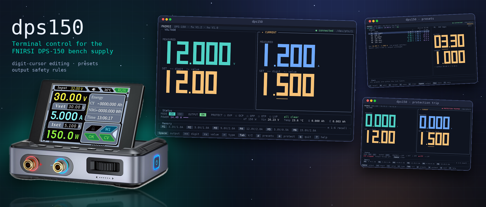
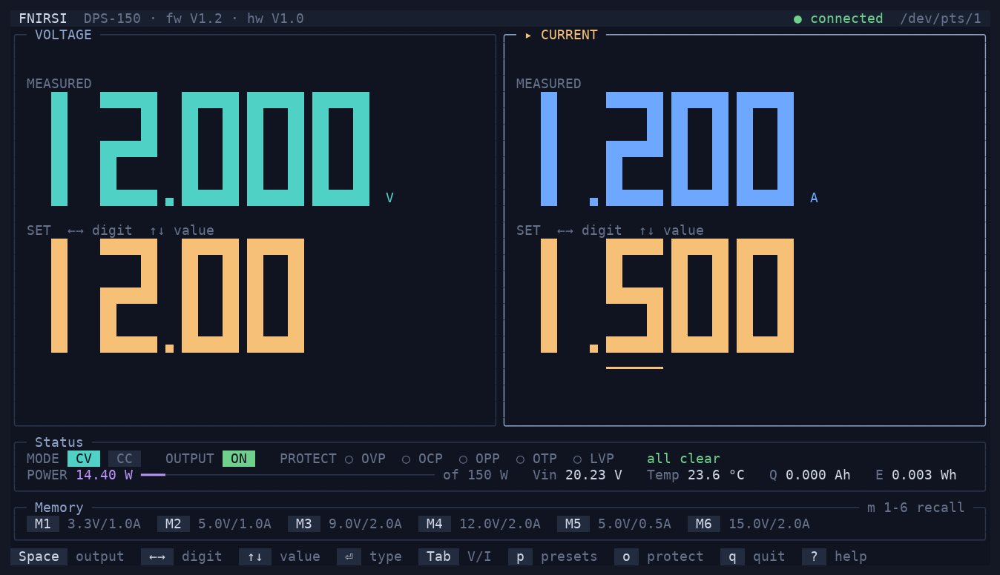
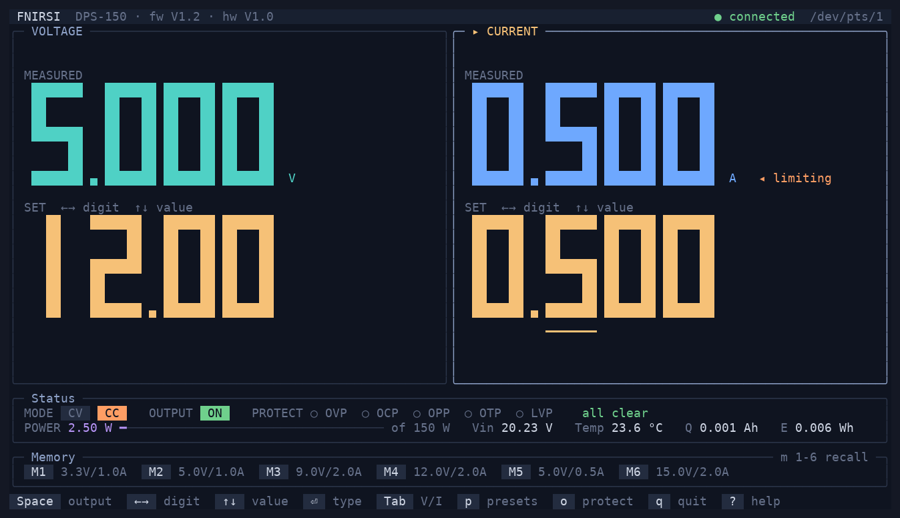
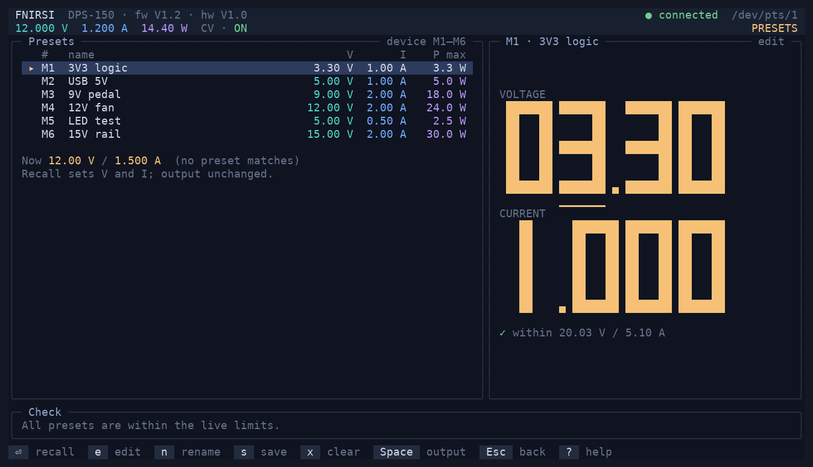
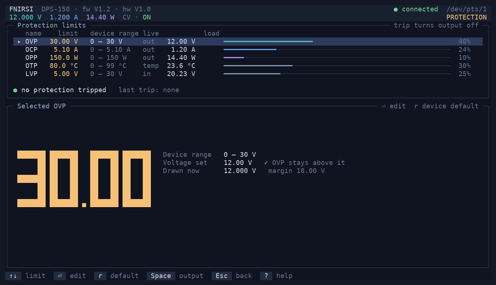

<h1 align="center">Terminal interface for FNIRSI DPS-150</h1>

<p align="center">
  A terminal interface for the <b>FNIRSI DPS-150</b> bench power supply.<br>
  Big digits, a digit cursor like an encoder knob, six presets, and safety rules for the output.
</p>

<p align="center">
  <a href="https://github.com/mmgalushka/dps150/actions/workflows/ci.yml"></a>
  <a href="https://codecov.io/gh/mmgalushka/dps150"></a>
  <a href="https://github.com/mmgalushka/dps150/releases/latest"></a>
  <a href="LICENSE"></a>
  
  
  
  
</p>

<p align="center">
  
</p>

## What it is

The DPS-150 is a small bench supply (0–30 V, 0–5 A, 150 W) with a USB port. FNIRSI ships a Windows program for it; **dps150** is a native terminal program for macOS and Linux.

- **Front-panel feel.** Two large readouts, voltage and current, each showing the measured value above the set value. Move a cursor to a digit and press `↑` / `↓`, like turning an encoder, or type a number.
- **Six presets.** M1–M6 live in the device; the app adds names. `m` then `1`–`6` recalls one.
- **Protection settings.** View and set OVP, OCP, OPP, OTP and LVP; trips are shown clearly and need an explicit clear.
- **Safe by design.** Turning the output on asks first, big jumps are held for confirmation, and a lost link never shows stale numbers as live. [Details below](#safety).
- **A simulator.** `dps150-sim` is a fake DPS-150, so you can develop, test and try the app with no hardware.

## Install

```
# macOS and Linux with Homebrew
brew install mmgalushka/tap/dps150

# Debian and Ubuntu: download the .deb from the latest release
sudo apt install ./dps150_<version>_<arch>.deb
```

Release archives for macOS (Apple silicon and Intel) and Linux (amd64 and arm64) are on the [releases page](https://github.com/mmgalushka/dps150/releases). To build from source, see [CONTRIBUTING.md](CONTRIBUTING.md#getting-started).

On Linux your user needs access to the serial port: `sudo usermod -aG dialout $USER`, then log in again (the `.deb` prints this note). macOS needs no setup.

> **Hardware testing so far:** developed and verified on macOS with a real DPS-150 (firmware V1.2). The Linux build passes CI with the simulator but has had little time on real hardware, so please tell us how it goes.

## Quick start

1. Connect the DPS-150 with its USB cable.
2. Run `dps150`. The port is found by USB ID (`2E3C:5740`); `--port /dev/cu.usbmodemXXXX` (macOS) or `--port /dev/ttyACM0` (Linux) overrides it.
3. Press `v` and type `5` then `⏎` to set 5 V, `i` for the current, `Space` to switch the output on (it asks first), `q` to quit.

```
dps150 [--port <path>] [--help] [--version]
```

Main keys: `←→` move the digit cursor, `↑↓` change the digit, `⏎` or `v` / `i` type a value, `Tab` switch V/I, `Space` output on/off, `Ctrl-X` output off, `m 1-6` recall a preset, `p` presets, `o` protection, `,` settings, `?` help, `q` quit. Press `?` on any screen for that screen's keys. Settings are saved in `~/.config/dps150/config.toml`, preset names in `presets.toml` (the preset *values* stay in the device).

The terminal must be at least 44 × 16; bigger terminals get bigger digits.

<details>
<summary>More screenshots</summary>

| Constant voltage | Constant current |
| --- | --- |
|  |  |

| Presets | Protection |
| --- | --- |
|  |  |

</details>

## Try it without a device

```
cargo run -p simulator --bin dps150-sim     # prints: dps150-sim: listening on <path>
dps150 --port <path>                        # in another terminal
```

Type commands into the simulator to inject conditions, for example `load 10` (a 10 Ω load), `trip otp` (an over-temperature trip) or `unplug` (the device goes silent). The full list is in [spec/SIMULATOR.md](spec/SIMULATOR.md).

## Safety

dps150 controls a real power output. It is careful, but it is not a substitute for judgement. The rules are written down in [spec/SAFETY.md](spec/SAFETY.md); in short:

- Turning the output **on** asks first (by default) and shows the voltage and current it will apply. Turning it **off** never asks, and `Ctrl-X` always does it.
- A large change of setpoint while the output is on is held until you confirm. Recalling a preset with the output on always asks.
- Values outside the device's limits are rejected, never silently clamped.
- If the USB link is lost, the numbers turn into dashes and the output state shows as unknown. **A DPS-150 whose cable is pulled keeps its output on** (verified on hardware), so the app cannot turn it off for you at that point.
- When you quit with the output on, the app asks whether to leave it on or switch it off.

dps150 is an independent, unofficial project and is not affiliated with FNIRSI. It is provided under the MIT license **without warranty**.

## Project documents

dps150 is built from a written specification: [how that works](CONTRIBUTING.md#spec-driven-development).

- [spec/MAIN.md](spec/MAIN.md): goals, scope, architecture, decision log (start here)
- [spec/PROTOCOL.md](spec/PROTOCOL.md): serial protocol of the device, verified on hardware
- [spec/DESIGN.md](spec/DESIGN.md): UI design: layout, colours, screens, interaction
- [spec/SAFETY.md](spec/SAFETY.md): safety and behaviour rules: limits, confirmations, link loss, quit
- [spec/APP.md](spec/APP.md): data binding, polling and update model, configuration files
- [spec/SIMULATOR.md](spec/SIMULATOR.md): the device simulator: purpose, behaviour, assumed behaviour, fault-injection commands
- [spec/REQUIREMENTS.md](spec/REQUIREMENTS.md): register of testable requirements with stable IDs, status and verification level
- [spec/PLAN.md](spec/PLAN.md): implementation plan: stages, milestones, hardware session, requirement coverage
- [DEVOPS.md](DEVOPS.md): toolchain, testing, CI, release and installation
- [CONTRIBUTING.md](CONTRIBUTING.md): how to contribute, spec-driven development, repository conventions
- [CHANGELOG.md](CHANGELOG.md): what changed in each release
- [SECURITY.md](SECURITY.md): reporting a problem

## Contributing

Bug reports, hardware test results and pull requests are welcome. Start with [CONTRIBUTING.md](CONTRIBUTING.md); in short: run `./helper.sh init`, then `./helper.sh run`, and if you change behaviour, change the spec first.

## Troubleshooting
- **Parts of the dps150 screen show up when I scroll the terminal after quitting.** dps150 draws on the terminal's alternate screen, which normally leaves no trace. iTerm2 can save that screen into scrollback: turn off Settings → Profiles → Terminal → "Save lines to scrollback in alternate screen mode".

## License

[MIT](LICENSE). Built with [Rust](https://www.rust-lang.org/) and [ratatui](https://ratatui.rs/); written largely by [Claude](https://claude.com/claude-code) from the specification in this repository.
